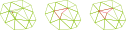
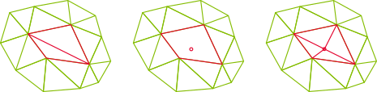
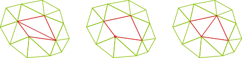
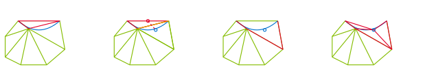
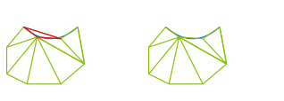

# Cavity operators

The remesher is built around local cavities, reconstructed and validated before writing any modification to the global mesh.

## Cavity definition

Given a seed entity $e$ (vertex or edge), the cavity $C(e)$ is the set of elements incident to $e$.

In the implementation:

- `init_from_vertex` builds a cavity from all elements around one vertex,
- `init_from_edge` builds a cavity from elements sharing one edge,
- global vertex IDs are mapped to local IDs (`local2global`) so reconstruction can be handled locally,
- boundary/interface information is split between internal faces, tagged faces, and tagged-face boundaries.

## Cavity reconstruction

For reconstruction, the boundary of the cavity is used to create a new local triangulation/tetrahedralization from a reconstruction vertex $\mathbf v$:

$$
\mathcal F(\mathbf v, C(e)) =
\left\{
K=(\mathbf v,\mathbf g_1,\ldots,\mathbf g_d)
\;\middle|\;
g=(\mathbf g_1,\ldots,\mathbf g_d) \in \partial C(e),\; \mathbf v \notin g
\right\}.
$$

### Filled cavity types

A filled cavity is evaluated with three reconstruction modes:

1. existing cavity vertex (`ExistingVertex`) for collapse and swap,
2. moved cavity vertex (`MovedVertex`) for smoothing,
3. new edge-center vertex (`EdgeCenter`) for split.

Each mode uses the same validation pipeline:

1. geometric validity and quality/length bounds (`FilledCavity::check`),
2. topology-preservation checks (`FilledCavity::check_topo`),
3. boundary-normal consistency against geometry (`FilledCavity::check_normals`).

## Operator-specific cavity usage

| Operation | Seed | Reconstruction | Example (2D) |
| --- | --- | --- | --- |
| Collapse | removed endpoint| kept endpoint |  |
| Split| edge | (projected) edge center |  |
| Swap| edge | the cavity boundary vertex that maximizes post-swap minimum quality. |  |

## Cavity extension 

When splitting boundary edges, it may happen that reconstructing the cavity from the projection of the edge center would create invalid elements. In this case `Cavity::extend` grows the cavity across a selected cavity boundary face by adding the adjacent element on the other side (same element tag required). 

 

Extension is repeated up to `max_extensions` times until all candidate reconstructed elements are valid.

## Element suppression

Elements can be removed if they have one (in 2D) or 2 (in 3D) faces on the boundary and if removing this element and tagging it's two untagged faces improves geometry representation. 

 

