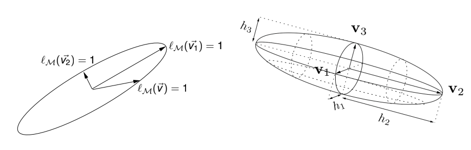
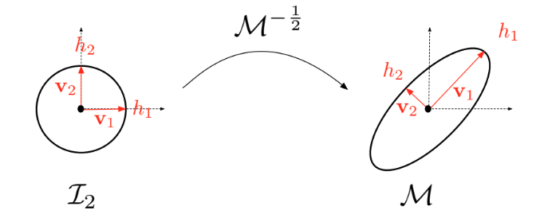

# Metric

## Metric and Euclidean metric space

An **Euclidean metric space** $(\mathbb{R}^d, \mathcal{M})$ is a finite-dimensional vector space where the dot product is defined by a symmetric positive-definite matrix $\mathcal{M}$:

$$\langle \mathbf{u}, \mathbf{v}\rangle_{\mathcal{M}} = \langle \mathbf{u}, \mathcal{M}\mathbf{v}\rangle = \mathbf{u}^\top\mathcal{M}\mathbf{v}, \text{ for } (\mathbf{u}, \mathbf{v})\in \mathbb{R}^d \times \mathbb{R}^d$$

The properties of $\mathcal{M}$ ensure that it defines a dot product. We will now refer to $\mathcal{M}$ as a metric tensor or metric.

### Canonical Euclidean metric space $(\mathbb{R}^3, \mathcal{I}_3)$

The most familiar example is the space defined by the identity matrix. The 2D canonical space uses $\mathcal{I}_2$ and the 3D canonical space uses $\mathcal{I}_3$.

### Geometric definitions in Euclidean spaces

The dot product induced by $\mathcal{M}$ defines distance in $\mathbb{R}^d$. In the following, $d\in\{2,3\}$.

* $\forall \mathbf{u}\in\mathbb{R}^d, \quad ||\mathbf{u}||_{\mathcal{M}}=\sqrt{\langle\mathbf{u},\mathcal{M}\mathbf{u}\rangle}$
* $\forall (\mathbf{a},\mathbf{b})\in\mathbb{R}^d \times \mathbb{R}^d, \quad d_{\mathcal{M}}(\mathbf{a},\mathbf{b})=||\mathbf{b}-\mathbf{a}||_{\mathcal{M}}=||\mathbf{a}\mathbf{b}||_{\mathcal{M}}$

The length $l_{\mathcal{M}}$ of a segment $\mathbf{a}\mathbf{b}=[\mathbf{a},\mathbf{b}]$ is then given by the distance between its extremities:

$$l_{\mathcal{M}}(\mathbf{a}\mathbf{b}) = d_{\mathcal{M}}(\mathbf{a},\mathbf{b})=||\mathbf{a}\mathbf{b}||_{\mathcal{M}}$$

Moreover, given a bounded subset $K$ of $\mathbb{R}^d$, the volume $|K|_{\mathcal{M}}$ is given by:

$$|K|_{\mathcal{M}} = \int_K\sqrt{\det\mathcal{M}}d\mathbf{x} = \sqrt{\det\mathcal{M}}|K|_{\mathcal{I}_d}$$

where $|K|_{\mathcal{I}_d}$ is the Euclidean volume of $K$.

Since $\mathcal{M}$ is symmetric, it is diagonalizable and admits the spectral decomposition:

$$\mathcal{M} = \mathcal{R} \Lambda \mathcal{R}^{\top}$$

where $\mathcal{R}$ is an orthonormal matrix composed of the eigenvectors $(\mathbf{v}_i)_{i=1,d}$ of $\mathcal{M}$:

$$\mathcal{R}=(\mathbf{v_1} \quad \dots \quad \mathbf{v_d})$$

verifying $\mathcal{R}\mathcal{R}^{\top} = \mathcal{R}^{\top}\mathcal{R} = \mathcal{I}_d$. $\Lambda=\text{diag}(\lambda_i)$ is a diagonal matrix composed of the eigenvalues of $\mathcal{M}$, denoted $(\lambda_i)_{i=1,d}$, which are strictly positive.

---

## Natural metric mapping

The metric $\mathcal{M}$ can be seen as a mapping from the unit ball $\mathcal{B}_{\mathcal{I}_d}$ of identity matrix $\mathcal{I}_d$ onto the unit ball $\mathcal{B}_{\mathcal{M}}$ of $\mathcal{M}$, where these unit balls are defined as:

$$
\begin{aligned}
    \mathcal{B}_{\mathcal{I}_d} &= \left\{ \mathbf{x} \in \mathcal{V}(\mathbf{a}) \mid (\mathbf{x}-\mathbf{a})^{\top}\mathcal{I}_d(\mathbf{x}-\mathbf{a})=1\right\} \\
    \mathcal{B}_{\mathcal{M}} &= \{ \mathbf{x} \in \mathcal{V}(\mathbf{a}) \mid (\mathbf{x}-\mathbf{a})^{\top}{\mathcal{M}}(\mathbf{x}-\mathbf{a})=1\}
\end{aligned}
$$

Here, $\mathcal{V}(\mathbf{a})$ denotes the vicinity of point $\mathbf{a}$. A visual representation of these unit balls is given in Figure 1. Note that $\mathcal{B}_{\mathcal{I}_d}$ defines the unit circle in 2D and the unit sphere in 3D.

> [!NOTE]
> **Figure 1:** *Geometric interpretation of the unit ball $\mathcal{B}_{\mathcal{M}}$ of $\mathcal{M}$. $\mathbf{v}_i$ are the eigenvectors of $\mathcal{M}$ and $\lambda_i=h_i^{-2}$ are the eigenvalues of $\mathcal{M}$. (Loseille 2011)*

$\mathcal{M}^{-\frac{1}{2}}$ is defined by the spectral decomposition:

$$\mathcal{M}^{-\frac{1}{2}}=\mathcal{R}\Lambda^{-\frac{1}{2}}\mathcal{R}^{\top} \quad \text{where} \quad \Lambda^{-\frac{1}{2}} = \text{diag}(\lambda_i^{-\frac{1}{2}})$$

Here, $\text{diag}$ denotes a 2D or 3D diagonal matrix. $\Lambda^{-\frac{1}{2}}$ defines the diagonal matrix of directional sizes $h_i = \lambda_i^{-\frac{1}{2}}$.

The mapping defined above is written in the form of the following application:

$$
\begin{aligned}
    \mathcal{M}^{-\frac{1}{2}} : \mathbb{R}^d &\longmapsto \mathbb{R}^d \\
    \mathbf{x} &\longrightarrow \mathcal{M}^{-\frac{1}{2}}\mathbf{x}
\end{aligned}
$$

> [!NOTE]
> **Figure 2:** *Natural mapping associated with metric $\mathcal{M}$. (Loseille 2008)*

For more details, see A. Loseille and F. Alauzet, *Continuous mesh framework. Part I: well-posed continuous interpolation error*, SIAM J. Numer. Anal., Vol. 49, Issue 1, pp. 38-60, 2011. [PDF](https://pages.saclay.inria.fr/frederic.alauzet/download/Loseille_Continuous%20mesh%20framework%20part%20I%20Well-posed%20continuous%20interpolation%20error.pdf)

## Metric validity and construction

`Metric::check()` verifies that a metric tensor stays in the range supported by the library.

> [!TIP]
> **`Metric::check()` error messages**
>
> | Message | Meaning / action |
> | --- | --- |
> | `Invalid metric: eigenvalue {s:e} < S_MIN` | An eigenvalue is too small. Eigenvalues are $h^{-2}$, so this means a directional size above $10^8$. |
> | `Invalid metric: eigenvalue {s:e} > S_MAX` | An eigenvalue is too large, i.e. a directional size below $10^{-8}$. |
> | `Invalid metric: anisotropy ratio {:e} > S_RATIO_MAX` | The ratio between the largest and smallest eigenvalues exceeds $10^{10}$, i.e. an anisotropy ratio above $10^5$. |
> | `Negative metric` | An isotropic metric has a negative size. Sizes must be non-negative. |
>
> The bounds are `S_MIN = 1e-16`, `S_MAX = 1e16`, and `S_RATIO_MAX = 1e10`. The check uses a `1e-8` relative tolerance on each bound.

> [!TIP]
> **Building an anisotropic metric from sizes**
>
> `AnisoMetric2d::from_sizes(s0, s1)` and `AnisoMetric3d::from_sizes(s0, s1, s2)` take one direction vector per principal axis, whose norm is the requested size along that axis: $\mathcal M = \sum_i \lVert\mathbf s_i\rVert^{-2}\,\mathbf d_i\mathbf d_i^\top$, with $\mathbf d_i = \mathbf s_i/\lVert\mathbf s_i\rVert$.
>
> - The directions are normalized internally and must be pairwise orthogonal: `|d_i · d_j| < 1e-12`, otherwise the constructor panics with `non orthogonal vectors`.
> - Eigenvalues are clamped to `[S_MIN, S_MAX]` and to an anisotropy ratio of `S_RATIO_MAX`; out-of-range sizes are therefore not rejected.

## Element quality

`Metric::quality(ge, metrics)` returns the metric quality of an element, normalized so
that an equilateral element in metric space has quality $1$. The minimum metric over
the element vertices is used.

> [!TIP]
> **`Metric::quality` messages**
>
> | Message | Meaning / action |
> | --- | --- |
> | `Dimension 0 elements are not supported` | Panic: quality is defined only for elements of dimension 1, 2, or 3. |
> | `q = {q:.2e}, ge = {ge:?}, vol = {vol:.2e}` | Internal assertion that the computed quality lies in $[0, 1]$. A violation indicates a degenerate element/metric combination or an implementation bug. |
>
> Elements with a non-positive physical volume return `-1.0` instead of panicking.

