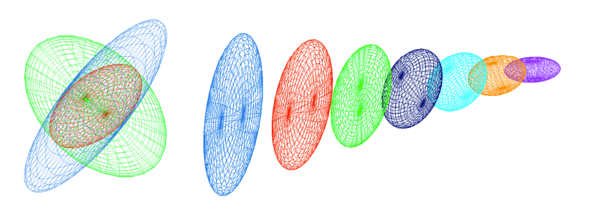
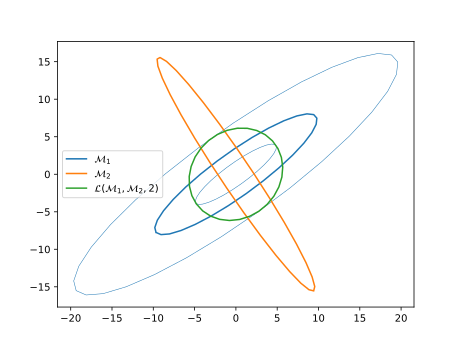

# Metric operations

Building a metric suitable for remeshing usually requires combining multiple constraints:
- interpolation from discrete data,
- intersection of directional constraints,
- lower and upper bounds on local sizes,
- controlled spatial variation (gradation),
- bounded step between consecutive adaptation metrics.

This chapter documents the assumptions and algorithms used in the lib.

## Metric interpolation

In practice, metric data can be stored at vertices, element centers, or both. Interpolation is therefore required to evaluate the metric at arbitrary points and to transfer data between locations.

A key requirement is commutativity: when interpolating multiple metrics, the result should not depend on operation order.

### Log-Euclidean framework

Following Arsigny et al. (2006), interpolation is performed in log-Euclidean coordinates.

For a symmetric positive-definite metric tensor
$$
\mathcal M = \mathcal R\,\Lambda\,\mathcal R^\top,
$$
its logarithm is
$$
\log(\mathcal M) := \mathcal R\,\log(\Lambda)\,\mathcal R^\top,
\qquad
\log(\Lambda)=\operatorname{diag}(\log\lambda_i).
$$

For a symmetric matrix
$$
S = \mathcal Q\,\Sigma\,\mathcal Q^\top,
$$
its exponential is
$$
\exp(S) := \mathcal Q\,\exp(\Sigma)\,\mathcal Q^\top,
\qquad
\exp(\Sigma)=\operatorname{diag}(\exp\xi_i).
$$

Define logarithmic addition and scalar multiplication:
$$
\mathcal M_1 \oplus \mathcal M_2
:=
\exp\!\left(\log(\mathcal M_1)+\log(\mathcal M_2)\right),
$$
$$
\alpha \odot \mathcal M
:=
\exp\!\left(\alpha\,\log(\mathcal M)\right)
=
\mathcal M^\alpha.
$$

### Interpolation formula

Let $(\mathbf x_i)_{i=1}^k$ be points with associated metrics $(\mathcal M(\mathbf x_i))_{i=1}^k$. If
$$
\mathbf x = \sum_{i=1}^k \alpha_i\,\mathbf x_i,
\qquad
\sum_{i=1}^k \alpha_i = 1,
$$
then the interpolated metric is
$$
\mathcal M(\mathbf x)
=
\bigoplus_{i=1}^k \alpha_i \odot \mathcal M(\mathbf x_i)
=
\exp\!\left(\sum_{i=1}^k \alpha_i\,\log(\mathcal M(\mathbf x_i))\right).
$$

This interpolation is commutative and preserves a maximum-principle behavior on edge determinants: if
$$
\det\mathcal M(\mathbf a) \lt \det\mathcal M(\mathbf b),
$$
then for all $t\in[0,1]$,
$$
\det\mathcal M(\mathbf a)
\lt
\det\mathcal M(\mathbf a+t\,\mathbf{ab})
\lt
\det\mathcal M(\mathbf b).
$$

## Metric intersection

Metric intersection combines several metric fields into one field that keeps the most restrictive size in every direction.

For two tensors $\mathcal M_1$ and $\mathcal M_2$, the intersected tensor $\mathcal M_{1\cap2}$ is the largest admissible tensor satisfying both directional constraints.

> [!NOTE]
> **Figure 1:** Left: metric intersection by simultaneous reduction. Right: interpolation along a segment (Loseille, 2008).

### Simultaneous reduction

Define
$$
\mathcal N := \mathcal M_1^{-1}\mathcal M_2.
$$

Let $(\mathbf e_i)$ be eigenvectors of $\mathcal N$ and let
$$
\mathcal P=(\mathbf e_1\;\mathbf e_2\;\mathbf e_3).
$$
In this basis, both metrics are diagonal by congruence:
$$
\mathcal M_1
=
\mathcal P^{-\top}\operatorname{diag}(\lambda_1,\lambda_2,\lambda_3)\mathcal P^{-1},
$$
$$
\mathcal M_2
=
\mathcal P^{-\top}\operatorname{diag}(\mu_1,\mu_2,\mu_3)\mathcal P^{-1},
$$
with Rayleigh coefficients
$$
\lambda_i = \mathbf e_i^\top\mathcal M_1\mathbf e_i,
\qquad
\mu_i = \mathbf e_i^\top\mathcal M_2\mathbf e_i.
$$

### Closed-form intersection

The intersection is
$$
\mathcal M_{1\cap2}
=
\mathcal P^{-\top}
\operatorname{diag}\!\left(\max(\lambda_1,\mu_1),\max(\lambda_2,\mu_2),\max(\lambda_3,\mu_3)\right)
\mathcal P^{-1}.
$$

Numerically in the lib, this is implemented through simultaneous reduction in `tucanos/src/metric/reduction.rs`.

## Metric gradation

Error-derived metrics can vary too abruptly. Gradation smooths the field by bounding variation rates.

### Spanning laws

Let $\mathbf p\in\Omega$ with metric $\mathcal M_{\mathbf p}$ and gradation parameter $\beta$.

1. Metric-space homogeneous law:
$$
\eta^2(\mathbf{px})
=
\left(1+l_{\mathbf p}(\mathbf{px})\,\ln\beta\right)^{-2}
=
\left(1+\sqrt{\mathbf{px}^\top\mathcal M_{\mathbf p}\,\mathbf{px}}\,\ln\beta\right)^{-2},
$$
$$
\mathcal M_{\mathbf p}(\mathbf x) = \eta^2(\mathbf{px})\,\mathcal M_{\mathbf p}.
$$

2. Physical-space homogeneous law:
if $\mathcal M_{\mathbf p}=\mathcal R\Lambda\mathcal R^\top$ with
$$
\Lambda=\operatorname{diag}(\lambda_i)_{i=1}^3,
$$
then
$$
\eta_i^2(\mathbf{px})
=
\left(1+\sqrt{\lambda_i}\,\lVert\mathbf{px}\rVert_2\,\ln\beta\right)^{-2}.
$$

A mixed law (Alauzet et al., 2021) blends both strategies with parameter $t\in[0,1]$.

In the lib, these formulas are used through metric spanning and edge-gradation control in `tucanos/src/metric/field/gradation.rs`.

> [!TIP]
> **Gradation warnings**
>
> Gradation is iterative and may stop before satisfying the target:
>
> | Message | Meaning / action |
> | --- | --- |
> | `gradation: target not achieved: max gradation: {c_max:.2}, {frac:.2e}% of edges have a gradation > {beta}` | The iteration limit was reached while some edges still exceed $\beta$. Increase `max_iter`, relax $\beta$, or smooth the input metric. |
> | `stop at iteration {n}, {k} elements cannot be fixed` | Metric extension could not assign a metric to `k` vertices, usually because the fixed-metric set or connectivity is insufficient. |
>
> Both are warnings; the function still returns the number of updated vertices.

### Reduction operator

The reduced metric at $\mathbf x$ is
$$
\widetilde{\mathcal M}(\mathbf x)
=
\left(\bigcap_{\mathbf p\in\Omega}\mathcal M_{\mathbf p}(\mathbf x)\right)
\cap
\mathcal M(\mathbf x).
$$

## Thresholds on local sizes

To enforce edge sizes in $[h_{\min},h_{\max}]$, diagonalize
$$
\mathcal M = R\operatorname{diag}(s_1,\dots,s_d)R^\top,
$$
and clamp each spectral value:
$$
\widetilde s_i = \min\!\left(\max\!\left(s_i,\frac{1}{h_{\max}^2}\right),\frac{1}{h_{\min}^2}\right).
$$
Then
$$
\mathcal T(\mathcal M,h_{\min},h_{\max})
=
R\operatorname{diag}(\widetilde s_1,\dots,\widetilde s_d)R^\top.
$$

## Element-implied metric

For an element $K$ with vertices $(\mathbf x_0,\dots,\mathbf x_d)$, the element-implied metric is the metric that makes $K$ equilateral in metric space.

If $J_{K,\Delta}$ maps the reference equilateral element to the physical element, then
$$
\mathcal M_K = (J_{K,\Delta}J_{K,\Delta}^\top)^{-1}.
$$

This is exactly the formula used in `tucanos/src/metric/field/implied.rs`.

> [!TIP]
> **Degenerate element**
>
> `MetricField::implied_metric(...)` inverts $(J_{K,\Delta}J_{K,\Delta}^\top)$ for every element and panics with `Degenerate element encountered` when that matrix is singular, i.e. for a zero-volume or flat element. Ensure every element has a positive measure before computing implied metrics.

## Controlling the step between two metrics

Given $\mathcal M_1$ (current metric), $\mathcal M_2$ (target metric), and a step bound $f\ge1$, define a controlled update that stays as close as possible to $\mathcal M_2$ while bounding directional change with respect to $\mathcal M_1$.

Constraint:
$$
\frac{1}{f}
\le
\sqrt{\frac{e^\top\mathcal M e}{e^\top\mathcal M_1 e}}
\le
f,
\qquad\forall e\neq 0.
$$
Equivalent spectral form:
$$
\frac{1}{f^2}
\le
\lambda_{\min}(\mathcal M_1^{-1/2}\mathcal M\mathcal M_1^{-1/2})
\le
\lambda_{\max}(\mathcal M_1^{-1/2}\mathcal M\mathcal M_1^{-1/2})
\le
f^2.
$$

With the $\mathcal M_1$-twisted Frobenius objective, the algorithm is:
1. Compute $\mathcal N := \mathcal M_1^{-1/2}\mathcal M_2\mathcal M_1^{-1/2}$.
2. Diagonalize $\mathcal N = Q\operatorname{diag}(\lambda_i)Q^\top$.
3. Clamp eigenvalues: $\widehat\lambda_i := \min(\max(\lambda_i,1/f^2),f^2)$.
4. Recompose $\mathcal N^\ast := Q\operatorname{diag}(\widehat\lambda_i)Q^\top$.
5. Map back $\mathcal M^\ast := \mathcal M_1^{1/2}\mathcal N^\ast\mathcal M_1^{1/2}$.

In the lib, this bounded-step construction is implemented in `tucanos/src/metric/reduction.rs`.

> [!NOTE]
> **Figure 2:** Controlled stepping with parameter $f=2$.

## Metric scaling

The final remeshing metric combines constraints and a global scale factor.

Given:
- an ideal metric $\mathcal M$,
- size bounds $(h_{\min},h_{\max})$,
- gradation bound $\beta$,
- step bound $f$ against the element-implied metric $\mathcal M_i$,
- optional fixed constraints $\mathcal M_f$ (for example curvature-radius or wall constraints),

the metric used by remeshing is
$$
\widetilde{\mathcal M}
=
\mathcal L\!\left(
\mathcal T(\alpha\mathcal M,h_{\min},h_{\max})\cap\mathcal M_f,
\mathcal M_i,
 f
\right).
$$

The scalar $\alpha$ is chosen to reach a target complexity
$$
\mathcal C(\widetilde{\mathcal M}) = \mathcal N,
$$
usually by bisection.

> [!TIP]
> **Scaling and complexity error messages**
>
> Global scaling first runs a simple fixed-point iteration, then an optional constrained bisection.
>
> | Message | Meaning / action |
> | --- | --- |
> | `Target complexity {n_elems} not reached: complexity {c:.2e}` | Warning emitted when the simple iteration stops before reaching the target. |
> | `Unable to scale the metric (simple)` | The simple iteration returned no valid scale. The warning above is emitted first. |
> | `Unable to scale the metric (bisection)` | The constrained bisection could not bracket the target complexity or did not converge within `max_iter`. Check the size bounds and fixed constraints. |
> | `The complexity of the constrain metric is {constrain_c:.2e} > n_elems = {n_elems}` | The fixed/constraint metric alone already requires more elements than the target. Increase the target or relax the constraints. |
>
> Simple scaling accepts the target when $|c-\mathcal N| < 0.05\,\mathcal N$; the same 5% tolerance is used to stop the bisection. The last message uses `constrain` (not `constraint`) verbatim.

## References

- V. Arsigny et al., *Log-Euclidean metrics for fast and simple calculus on diffusion tensors*, 2006.
- F. Alauzet, *Size gradation control of anisotropic meshes*, 2010.
- F. Alauzet and L. Frazza, *Feature-based and goal-oriented anisotropic mesh adaptation for RANS applications*, 2021.
- A. Loseille and F. Alauzet, *Continuous mesh framework. Part I*, SIAM J. Numer. Anal., 2011.
