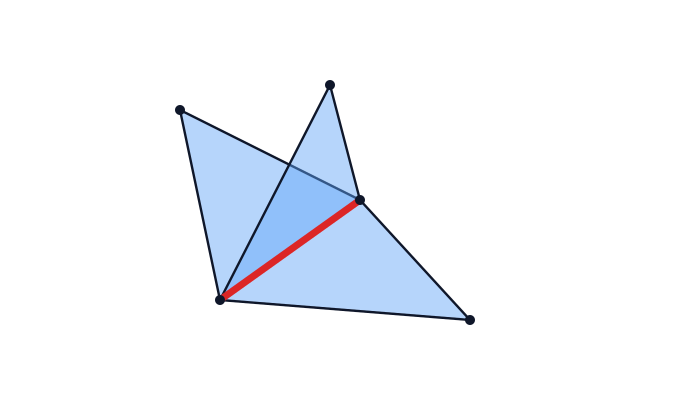
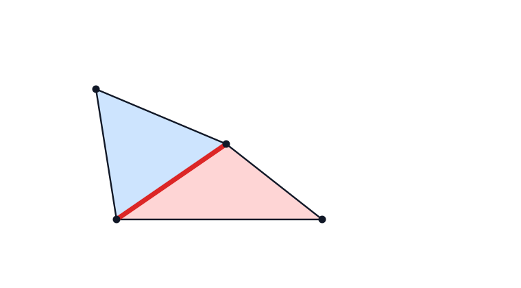
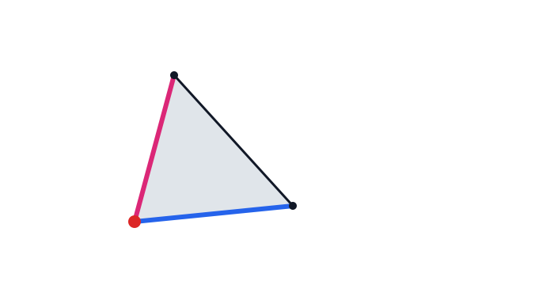
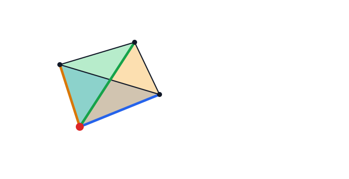
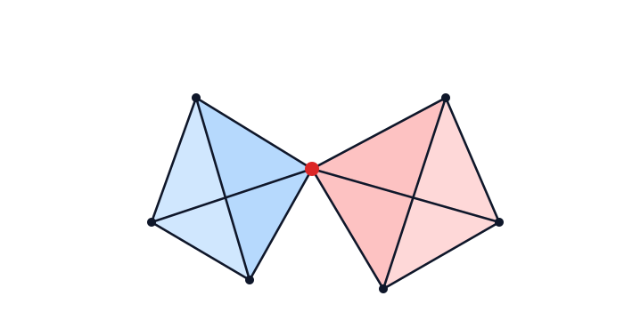
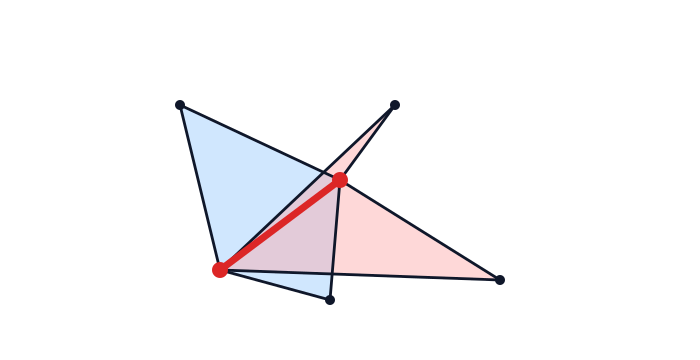
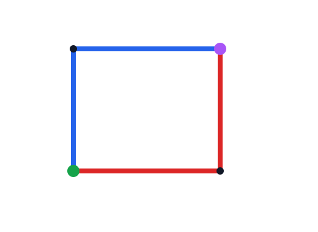
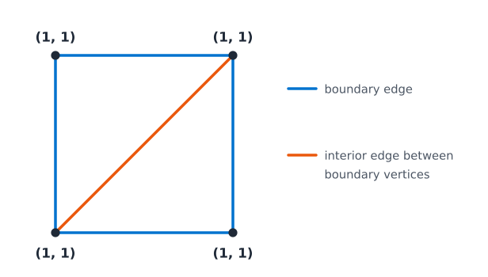

# Topology hierarchy

The objective of the topology hierarchy is to represent parent/child links across dimensions (cell → face → edge → vertex) that should be preserved when doing mesh adaptation.

## Tagged entities (edges and nodes)

In addition to the tagged elements and faces present in the mesh, edge and node tags are introduced as follows.

### Edges (Tetrahedra only)

Edges are tagged if they belong to:
- two tagged faces with different tags 
- or to more than two tagged faces

> [!TIP]
> **Examples:**
> | Three triangles with the same tag | Two triangles with different tags |
> | --- | --- |
> |  |  |

> [!NOTE]
> An edge cannot belong to a single tagged face for tetrahedra meshes

### Node tags

Nodes are tagged if they belong to:
- two tagged edges (i.e. faces for triangle meshes) with different tags
- or to more than two tagged edges
- or to a single tagged edge
- **or if multiple surfaces touch at a vertex**

> [!TIP]
> **Examples:**
>
> | A corner in 2D | A corner in 3D |
> | --- | --- |
> |  |  |
> | Single vertex contact (3D)| Edge end nodes (3D)|
> |  |  |

#### Single vertex contact

Two (or more) surface patches meet at one vertex while not being connected through an edge around that vertex.

##### Detection

Detection proceeds as follows:

1. Pick candidate vertex $i$.
2. Collect all incident triangles around $i$:
	 - in tetra meshes: incident boundary/interface faces,
	 - in 2D surface-in-3D cases: incident mesh triangles.
3. For each incident triangle, collect only edges **not containing** $i$.
4. Build an auxiliary graph from those opposite edges.
5. Compute connected components of this auxiliary graph.
6. If the graph has more than one connected component, classify as single-vertex contact.

Intuition: if the ring around $i$ is disconnected once edges through $i$ are removed, then local sheets touch only at $i$.

> [!NOTE]
> Detection is applied on tagged mesh faces, not on all tetra faces from raw element connectivity. Therefore, correctness relies on consistent face tagging first.

> [!TIP]
> **Implementation highlights:** The algorithm above is implemented in the topology module through dedicated routines for single-vertex contact detection and repair. The implementation builds the same auxiliary opposite-edge graph, computes connected components, and introduces intermediate topological entities when needed to keep parent/child relations consistent.

## The topology hierarchy graph

### Structure

The implementation in `tucanos/src/mesh/topology.rs` represents topology as a layered directed acyclic graph (DAG).

Nodes represent topological tags at a given dimension and directed links between adjacent dimensions (parent/child). `TopoNode` stores:
- `tag: (dim, tag)` (nonzero tag value),
- `parents: set<Tag>`: parent tags in dimension `dim+1`,
- `children: set<Tag>`: child tags in dimension `dim-1`.

The graph contains the different nodes as well as some cached information to efficiently get common parent information. `Topology` stores:
- `entities[dim]`: all nodes grouped by dimension,
- `parents[(TopoTag, TopoTag)] -> TopoTag`: cache of closest common parents,
- `dim`: maximum topological dimension of the hierarchy.

In practice, for mesh topological dimension $d$:
- layer $d$ contains the element tags,
- layer $d-1$ contains the face tags,
- lower layers contain the inferred edge/node tags (3D) or inferred node tags (2D) (see [here](#tagged-entities-edges-and-nodes))

### Validity

For a valid mesh of topological dimension $d$, the graph is considered valid if 
- graph entities of dimension $d$ correspond to the unique element tags
- graph entities of dimension $d-1$ correspond to the unique face tags
- every graph node of dimension $d' < d$
    - the parent set is not empty, and each parent reference points to an existing node of dimension $d'+1$,
	- for edges and nodes, does not share its parent set with another node of dimension $d'$,
- for all mesh tagged entities (of dimension $d' < d$), the set of parent tagged entity tags must match exactly the parent set of the corresponding graph node.

> [!WARNING]
> **Example of invalid tag hierarchy (node level):**
>
> 
>
> The two highlighted nodes have the same parent tag set (one blue edge tag + one red edge tag), but they are assigned different node tags. This violates the validity rule that tagged entities with identical parent-tag sets must map to one unique topology node tag.
> 

> [!TIP]
> **Topology construction error messages**
>
> Inconsistent tags are reported by `get_from_parents_or_create` and by construction assertions:
>
> | Message | Meaning / action |
> | --- | --- |
> | `Multiple nodes with parents {:?}: {nodes:?}` | More than one node of the same dimension has the same parent set, as in the example above. Enforce the one-parent-set/one-tag rule. |
> | `Some vertices are not tagged` | Construction left a vertex unresolved, typically because face tags are incomplete or inconsistent. |
> | `Tag {tag:?} already exists with parents {existing_parents:?}. parents = {parents:?}` | Two entities use the same tag with different parent sets. Mesh-provided tags conflict with the inferred hierarchy. |
> | `Invalid parents for face tag {t}: {inferred:?} != {stored:?}` | A mesh face tag is reused for a face whose parent element-tag set differs from the stored one. |
> | `TopoTag {:?} not present` | A node references a parent tag that does not exist in the layer above. |
> | `tag cannot be 0` | A zero tag was inserted; topology tags must be nonzero. |
> | `Invalid dimension` | A topology layer outside `[0, dim]` was requested. |
> | `Invalid elem dimension: {d}` | `MeshTopology::new` only supports elements of dimension 2 or 3. |
> | `Face {f:?} not found in f2tag` | A mesh face is missing from the face-to-element map, so the face list and element connectivity disagree. |
>
> Face-tag inconsistencies that trigger these errors are described in [Tags](tags.md#face-tagging-errors).

### Vertex tags

Each vertex of the mesh is assigned the tag of the tagged entity of lowest dimension it belongs to (by construction there is only one such entity). The result is one `(dim, tag)` pair per vertex, stored as `vtags`; here $d$ is the element dimension and $D$ the ambient dimension (for a volume mesh, $D = d$):

| `dim` | Vertex belongs to | Vertex location in a tetrahedral mesh |
| --- | --- | --- |
| `d` | an element tag | inside the volume of that element tag |
| `d - 1` | a face tag | on a tagged surface or interface patch |
| `1` | an edge tag | on a tagged edge, where surface patches meet |
| `0` | a node tag | at a tagged corner |

For a triangle mesh ($d = 2$), the same table applies with `dim = d` inside an area region, `dim = 1` on a tagged edge and `dim = 0` at a corner.

A vertex that belongs to several tagged entities of the same dimension with different tags cannot keep a single one of them. The single-vertex-contact fix then gives it a node tag `(0, tag)` (see [Single vertex contact](#single-vertex-contact)), so that a vertex tag always names exactly one entity. Local operations maintain `vtags`: a split inserts the new vertex with the tag of the split edge, and the other operators keep the tags of the surviving vertices.

#### Locating an edge from tags

The local operators need to know, for every edge, whether it lies inside the volume, on a surface or on a tagged edge. This edge tag `(dim, tag)` drives splitting, swapping, collapsing and projection, and is resolved from the vertex tags together with the tagged faces:

1. **Interior shortcut from the vertex tags.** If an endpoint has `dim = d` (an element tag), no tagged face, edge or node passes through that vertex, so every incident edge is interior: the edge tag is that vertex tag.
2. **Otherwise both endpoints lie on lower-dimensional entities**, and the edge tag follows from the tagged faces that contain the edge:
	 - no tagged face contains it: the edge is interior to the element tag shared by its incident elements, `(d, tag)`;
	 - all the tagged faces containing it share one tag `t`: the edge lies on that patch, `(d - 1, t)`;
	 - they carry at least two different tags: the edge is shared by several patches, and its tag is the tagged edge `(1, t_e)` whose parent set in the hierarchy is exactly that set of face tags;
3. a negative `tag` marks a fixed entity, which the operators must preserve.

For a triangle mesh, an edge is a face, so step 2 is a direct lookup of the edge in the tagged-face map: a tagged edge gives `(1, t)`, and an untagged edge is interior to the element tag shared by its adjacent triangles, `(2, t)`. The operators additionally force that interior classification when the two adjacent triangles carry the same tag, since such an edge can never be a boundary edge.

#### Why vertex tags alone are not sufficient

`vtags` summarize the position of a vertex, not of an edge. A vertex tagged `(d - 1, t)` only records that some tagged face passes through it, while most of its incident edges may still be interior. Two endpoints may even both lie on the same patch and still bound an edge that runs through the volume, and a corner vertex `(0, t)` can be shared by several patches, so its tag does not say which patch an incident edge follows. The interior shortcut is the only guarantee that vertex tags provide: they cannot prove that an edge lies on a patch or on a tagged edge, and a lower-dimensional vertex tag is not inherited by its incident edges.

> [!TIP]
> **Reading the figure.** The two triangles carry a single element tag `1`: the four sides of the square are faces of a single triangle, so they are tagged (blue), while the shared diagonal is shared by two elements with the same tag, so it is untagged. Every corner belongs to tagged boundary faces (dimension `1 = d - 1`) and to no lower-dimensional tagged entity, so `vtags` gives all four corners the same tag `(1, 1)`. The diagonal (orange) joins two of these boundary vertices and is interior nonetheless, so the vertex tags at its endpoints are indistinguishable from those of a boundary edge: only the tagged-face map records that the diagonal is not a tagged face.

Deciding the edge tag therefore requires the tagged faces around the edge, and those faces must be stored. The mesh provides face tags, but the remesher modifies connectivity locally, so it keeps its own face-to-tag map, built from the mesh face tags at initialization and updated by every split, collapse and swap. This map is queried for each edge, and it also drives the cavity checks that prevent tagged faces from being pinched. Edge tags are not stored on the mesh: the hierarchy stores them only for edges that belong to two tagged faces with different tags or to more than two tagged faces, and the parent query above recovers the tag of such an edge from the face tags.

The three sources are complementary:

| Source | Provides |
| --- | --- |
| `vtags` | the lowest-dimensional entity at each vertex, hence the interior shortcut |
| tagged-face map | which tagged patches meet along a given edge |
| hierarchy parents | the edge tag shared by a set of face tags |

The resolved tag then conditions the local operators:

- splitting projects the new point onto the geometry when `dim < D` and uses boundary quality thresholds when `dim < d`, and never splits a fixed (negative) tag;
- swapping never swaps a tagged edge (`dim = 1`), because the new diagonal would leave the intersection curve of the patches;
- collapsing processes edges by increasing tag dimension, requires the edge tag to be carried by one of the endpoints, and never merges two corner vertices (`dim = 0`).

### Construction

Topology construction follows a deterministic update procedure.

High-level construction sequence:

1. Initialize per-vertex temporary tags to unresolved state.
2. Insert top-dimensional element tags (dimension `d`).
3. Build face→element incidence and process all mesh faces:
	 - check existing face-tag node parent consistency, or
	 - insert missing face-tag nodes.
4. If mesh topological dimension is 3:
	 - infer edge tags from face-parent sets,
	 - infer node tags from edge-parent sets,
	 - run single-vertex-contact fix.
5. If mesh topological dimension is 2:
	 - infer node tags from face-parent sets,
	 - for surfaces embedded in 3D, run single-vertex-contact fix.
6. Assert that all vertices are resolved.
7. Precompute closest-common-parent cache:
	 - for each node, collect all descendants recursively,
	 - map every descendant pair to that ancestor,
	 - iterate from highest to lowest dimension so closest parents overwrite farther ancestors.

The output is:
- a dimension-layered DAG of topology tags,
- vertex topology tags `vtags`,
- `parent(a, b)` queries in O(1) average hash lookup time.

#### How validity conditions are enforced during construction

The checks listed in [Validity](#validity) are enforced by construction guards and consistency checks:

1. **Top-level tag layers match mesh tags**
	- Element layer ($d$) is populated from element tags.
	- Face layer ($d-1$) is populated from face tags using the explicit face-to-element incidence.

2. **Parent sets are non-empty and references are valid**
	- Node insertion rejects invalid tags (including zero-tag values).
	- Every parent reference is validated against existing upper-layer nodes before insertion.
	- This guarantees each inserted lower-dimensional node references existing parents.

3. **Uniqueness of node per parent-set (for inferred tagged entities)**
	- For each inferred entity, existing nodes with exactly the same parent set are queried first.
	- Cases:
		- none found: create one node,
		- exactly one found: reuse it,
		- multiple found: return an error.
	- This enforces the one-parent-set/one-tag rule used for inferred edge/node tags.

4. **Consistency of mesh-provided tagged entities**
	- For faces carrying mesh tags, construction checks:
		- if a face tag already exists, the inferred parent set must equal the stored parent set,
		- otherwise insert with inferred parents.
	- This is where mismatched tagged-entity hierarchy is rejected.

5. **Special non-manifold vertex-contact handling**
	- Single-vertex-contact handling detects disconnected rings around a vertex and injects missing intermediate tags.
	- This restores representable parent/child relations without adding geometric entities.

6. **Final completeness check for vertex topology tags**
	- After all propagation/fixes, no unresolved vertex tag may remain.
	- If unresolved tags remain, topology construction fails.

> [!TIP]
> **Implementation highlights:** In the Rust implementation, the above steps are handled by a small set of construction and consistency routines (node insertion, parent-set reuse/creation, tagged-face update, and single-vertex-contact repair), together with explicit validity assertions at each stage.

##### Ghost edge tags

When a single-vertex contact is detected, ghost edge tags are introduced so the topology DAG can represent all incident sheets consistently.

Implementation behavior:

- Gather local face tags `ftags` around the vertex.
- In tetra meshes, also inspect incident element tags; if multiple element tags meet at the vertex, ensure corresponding interface face tags exist (create them if needed) and add them to `ftags`.
- Depending on current vertex-topology state `(dim, tag)`:
	- `dim == 2`: create/find one edge tag from all `ftags`, then create/find node tag from that edge tag,
	- `dim == 1`: add missing edge tag(s) for face tags not already represented under current branch, then create/find node tag combining old and new edge branches,
	- `dim == 0`: extend existing node parent edge-tag set with missing ghost edge tag(s), then create/find the merged node tag.

These ghost tags do not add geometric entities; they add missing topological branches so parent/child relations and `parent(a,b)` queries remain consistent.
